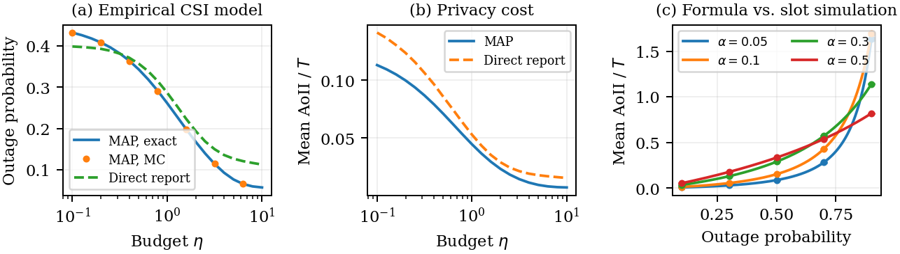
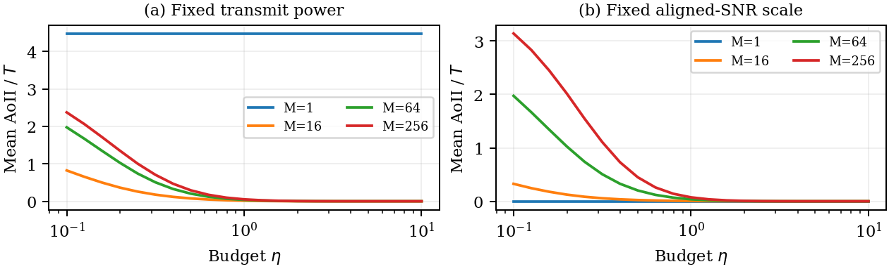
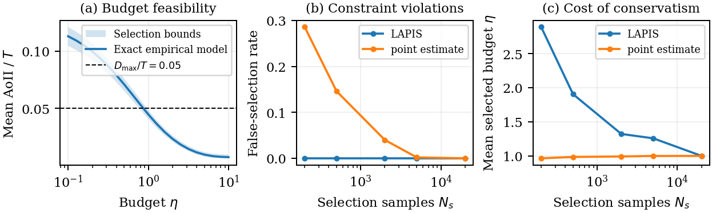

# The Price of Location Privacy

**Age of Incorrect Information in Location-Aided UAV Communications**

Reproducibility materials for a conference-paper draft intended for ICC 2027. This is a research draft, not an accepted publication. The author block remains a placeholder pending final author information.

[Paper PDF](paper/IEEE-conference-template-062824.pdf) | [LaTeX source](paper/IEEE-conference-template-062824.tex) | [Reference parameters](reference_results/basic_v1/parameters.csv)

A single-antenna UAV reports a 3D Laplace-perturbed location to a multi-antenna base station. MAP location inference selects a frozen receive beam. Privacy-induced outage is linked to age of incorrect information (AoII) for a symmetric binary task source. **LAPIS** (Location-Aware Privacy--Information Selection) chooses a fixed disclosure budget using simultaneous confidence bounds and independent confirmation.

## Reproduce all paper experiments

Tested with Python 3.13.11 on Windows; the pinned packages require Python 3.11 or newer. No GPU, WRF-GS, NeRF2, or additional dataset download is required for the bundled empirical model.

```bash
git clone https://github.com/jwentong/Location-Privacy-Based-Resource-Allocation.git
cd Location-Privacy-Based-Resource-Allocation
python -m venv .venv
# Linux/macOS: source .venv/bin/activate
# Windows PowerShell: .venv/Scripts/Activate.ps1
python -m pip install -r requirements.txt
python -m unittest discover -s Experiments -p "test_*.py"
python reproduce.py
```

`reproduce.py` runs the complete suite, generates the parameter table and three figure groups, and compares generated numerical CSVs against the committed reference results. It does not simply copy the reference tables. Outputs go to `Experiments/results/basic_v1/`; committed `reference_results/basic_v1/` stays unchanged. Running again overwrites only generated outputs. The original run took about 89 seconds; runtime depends on hardware and numerical-library threading. The wrapper limits BLAS/OpenMP threads for repeatability. Different platforms may introduce small floating-point differences.

To check an existing run without rerunning: `python verify_results.py`.

## Expected results and figure mapping

| Experiment | Expected result | Output |
|---|---|---|
| Mechanism and theory | At normalized budget eta=1, MAP AoII 0.04462115 versus direct-report 0.05297264 (15.8% reduction) | `mechanism.csv`, `theory_validation.csv`, `figures/mechanism_theory.pdf` |
| Array-size controls | At eta=0.1 and fixed transmit power, AoII rises from about 0.823 (M=16) to 2.373 (M=256) | `array.csv`, `rayleigh_control.csv`, `figures/array_effect.pdf` |
| Budget and reliability | With 200 selection samples per scenario/budget: point-estimate selection violates the AoII threshold in 143/500 trials; LAPIS in 0/500 | `budget_selection.csv`, `reliability.csv`, `figures/selection_reliability.pdf` |
| Parameter table | Fixed seeds, budgets, sample counts, calibration, and model settings | `parameters.csv`, `config.json` |

Zero observed violations does not establish zero violation probability. With 500 trials, the two-sided 95% Clopper--Pearson upper bound for 0/500 is about 0.735%. The reliability target is AoII 0.05; stronger confidence protection can require a larger disclosure budget.





## Data provenance and rebuilding from the public source

Source: Colpaert, Achiel; Thys, Cel; Cui, Zhuangzhuang; Pollin, Sofie, **MaMIMO-UAV 3D Channel State Information Dataset**, KU Leuven RDR, [doi:10.48804/0IMQDF](https://doi.org/10.48804/0IMQDF). The saved API manifest records dataset version 3.0, released October 2, 2026. The March 2023 acquisition used here is unchanged. The dataset and redistributed derivatives retain **CC BY-NC 4.0**, including attribution and noncommercial-use conditions; see [DATA_LICENSE.md](DATA_LICENSE.md).

Bundled derivatives: `Experiments/data/aligned/session.npz` (500 aligned 64-channel snapshots), and `Experiments/data/frozen/map.npz` (7 covariance beams, 287 training indices, 102 held-out snapshots; 111 samples discarded). JSON sidecars document source hashes and processing. These small files make the paper experiments independent of a 1.28 GB raw download. Their hashes are recorded in `data_manifest.json`.

Optional complete raw-data rebuild (about 1.28 GB plus trajectory):

```bash
python download_data.py
python Experiments/measured_pipeline.py align --channel Experiments/data/raw/20230316_154153_n64_l1_s50000_sr2_f2.610G_g30.0.bin --trajectory Experiments/data/raw/Mar-16th-2023-04-40PM-Flight-Airdata.csv --output Experiments/data/aligned/session.npz
python Experiments/measured_pipeline.py freeze --input Experiments/data/aligned/session.npz --output Experiments/data/frozen/map.npz
python reproduce.py
```

The downloader uses official file IDs 119641 and 119648 and verifies SHA-256. It never disables TLS certificate checks. Raw files are git-ignored. Alignment uses subcarrier 50, stride 100, zero clock offset, and GPS interpolation with gap rejection. Complex CSI follows the provider binary convention. XY coordinates are local meters; altitude is relative to takeoff, not verified absolute BS altitude. Freezing uses 10 m cells, a 2 m guard band, a 0.7 cell-training fraction, and seed 20261027. NPZ ZIP-container hashes can differ across rebuilds despite identical arrays; numerical reproduction is the final check.

## Statistical protocol and limits

- Normalized budget eta=epsilon*r0, r0=10 m, 21 log-spaced budgets from 0.1 to 10; task flip probability alpha=0.1. Privacy is per report; repeated reports compose and do not imply bounded lifetime privacy.
- The measured experiment uses three data-derived representative cell centers, a uniform prior, equal scenario weights, and IID resampling of held-out CSI within each cell (7, 17, and 78 snapshots). It evaluates a fixed hovering-location conditional model, not temporally correlated flight-trace AoII. Training-only median CSI energy sets the common nominal 10 dB SNR scale; this is not an absolutely calibrated RF link budget.
- The frozen map returns a covariance-principal receive beam using location only. Actual held-out CSI evaluates gain but is not supplied to the beam controller. Direct-report lookup uses the same frozen map without MAP projection.
- Compute nonlinear AoII per scenario and then average. The source recursion is independently validated over 29 configurations, each using 5,000,000 slots after burn-in. AoII is reported in slot units.
- The array experiment is a separate ideal Rician geometric control (M=1,16,64,256), not subarray extraction from the measurement. Fixed-power and equal-aligned-SNR cases are distinguished; Rayleigh provides a direction-insensitive control.
- Selection uses physical noise/CSI samples; confirmation and reliability repetitions use independent, marginally equivalent Bernoulli draws conditional on the same finite empirical bank. Confidence bounds address Monte Carlo error conditional on that bank, not uncertainty about the true channel population. Main Ns=20,000, Nc=100,000, failure-probability split 0.025+0.025, and 500 reliability repetitions at each tested Ns. Shared random numbers across budgets are intentional; union bounds do not require independence across budgets.
- `run_basic_experiments.py` is the fixed **basic_v1 paper protocol**, not a general parameter-sweep API. Some analytical controls explicitly use the paper's alpha, threshold, and geometry constants; changing CONFIG alone is not a supported new experiment. Create and validate a separate protocol for extensions.

## Build the paper

A TeX installation needs IEEEtran, amsmath, algorithm/algorithmic, TikZ, cite, and hyperref. From the repository root:

```bash
cd paper
pdflatex -interaction=nonstopmode -halt-on-error IEEE-conference-template-062824.tex
pdflatex -interaction=nonstopmode -halt-on-error IEEE-conference-template-062824.tex
```

References are embedded; BibTeX is not required. The included draft PDF is six pages. To update its result panels after a modified run, copy the three generated figure PDFs into `paper/Figs/` before recompiling. The title uses an explicit two-line break and 22 pt font.

## Repository layout and reuse

- `Experiments/`: simulation, preprocessing, and unit tests.
- `Experiments/data/`: attributed empirical derivatives and preprocessing metadata.
- `reference_results/basic_v1/`: original numerical results, parameter table, and figures.
- `paper/`: draft PDF, editable LaTeX sections, system diagram, and result figures.
- `reproduce.py`, `verify_results.py`, `download_data.py`: reproduction entry points.

No blanket software or manuscript license is asserted by this initial release; public visibility alone does not grant unrestricted reuse rights. Contact the repository owner for code/manuscript reuse beyond applicable law. Third-party data licensing remains separate. `paper/IEEEtran.cls` retains its original notices. Please cite the dataset above and identify this repository and commit when reporting a reproduction; a final paper citation will be added after publication.
